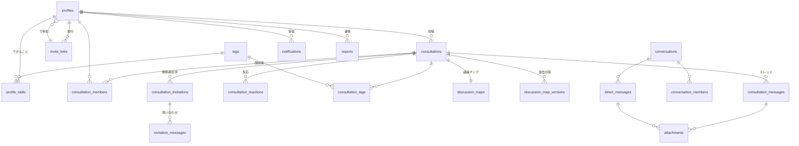
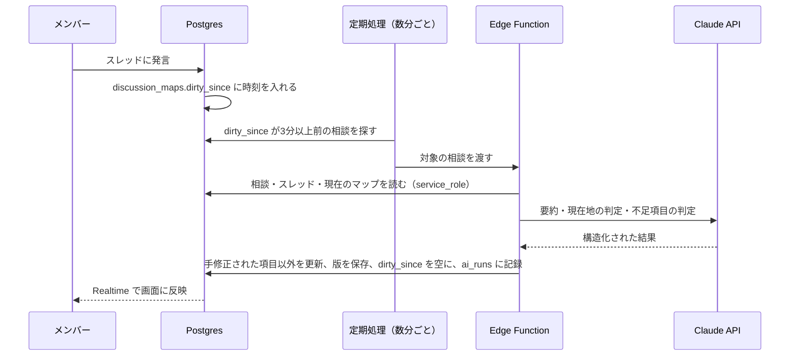

# データ設計（v0.1）

> 要件：[requirements.md](./requirements.md) ／ 画面：[screens.md](./screens.md) ／ 決定記録：[decisions.md](./decisions.md)
> 実体の SQL：[`supabase/migrations/20261108000000_init.sql`](../supabase/migrations/20261108000000_init.sql)
> 検証シナリオ：[`supabase/tests/`](../supabase/tests/)

---

## 1. 方針

| 方針 | 内容 |
| --- | --- |
| 基盤 | Supabase（Postgres）。ログインは Supabase Auth、メール・電話番号は `auth.users` にだけ持つ（他メンバーから見えない） |
| 権限 | **誰が何を見られるかは全部 DB の行レベルセキュリティ（RLS）で判定**。画面側の表示制御に頼らない |
| 直接書き込み | 本文の編集など単純な操作だけ。アプリから変えてよい列を列単位で許可 |
| RPC（DB 関数） | 公開範囲の変更、関係者招待、管理者操作など**ルールを伴う操作は必ず関数経由**。関数の中で権限チェック・自動メッセージ・通知までまとめて行う |
| AI の処理 | DB は「更新が必要」という印を付けるだけ。実際の AI 呼び出しはサーバー側の処理（Edge Function）が行う |
| 退会 | プロフィールを削除し、発言は残す。発言者が空になった発言は「退会したメンバー」と表示 |

---

## 2. 全体図

---

## 3. テーブル

### 3.1 メンバー・招待

| テーブル | 役割 | 主な列 |
| --- | --- | --- |
| `profiles` | メンバー（`auth.users` と 1対1） | 表示名、アイコン、自己紹介、相談受付ステータス（open / busy / paused）、**role（member / admin）**、**status（active / suspended）**、招待した人、使った招待リンク、文字サイズ |
| `invite_links` | 招待リンク | **トークンのハッシュ**（本体は保存しない）、発行者、メモ、使用回数の上限と実績、有効期限、無効化日時 |
| `admin_audit_logs` | 管理操作の記録 | 誰が・何を・誰に（格上げ、停止、リンク発行など） |
| `invite_claims` | 招待の予約 | どの連絡先（メール／電話番号）がどの招待リンクで登録するか、ユーザー作成を許す期限（1時間）、使用済みか。**登録前フックがこれを見てユーザー作成を許可する**。アプリからは直接読めない |

### 3.2 できること

| テーブル | 役割 | 主な列 |
| --- | --- | --- |
| `tags` | タグの辞書 | 名前（大文字小文字を区別せず一意）、**統合先**（タグ整理用） |
| `profile_skills` | メンバー × タグ | 種類（**can = できること / learning = 勉強中**）、経験（少し / そこそこ / 本職）、実績・ひとこと、並び順 |

### 3.3 相談

| テーブル | 役割 | 主な列 |
| --- | --- | --- |
| `consultations` | 相談 | 投稿者、タイトル、本文、**公開範囲（public / restricted）**、ステータス、**管理者閲覧の許可（初期値 true）**、**AI 利用（初期値 true）**、最終更新 |
| `consultation_members` | 関係者 | 相談、メンバー、**参加経路（author / invitation / narrowing）**、誰が加えたか。投稿者も必ず1行入る |
| `consultation_messages` | スレッドの発言 | 種類（**user / system**）、本文、システムメッセージの内容（`event`）、メンション、編集・削除日時 |
| `consultation_reactions` | 反応 | 「話聞けます」「詳しい人知ってます」 |
| `consultation_tags` | 相談のタグ | 付けたのが投稿者か AI か |

### 3.4 関係者招待

| テーブル | 役割 | 主な列 |
| --- | --- | --- |
| `consultation_invitations` | 関係者招待 | 招待された人、招待者、ひとこと、**状態（pending / accepted / declined / canceled / expired）**、期限（作成から14日）。同じ人への承認待ちは1件まで |
| `invitation_messages` | 承認前の問い合わせ | 招待に紐づく会話。参加できるのは招待された人・招待者・投稿者 |

### 3.5 議論マップ

| テーブル | 役割 | 主な列 |
| --- | --- | --- |
| `discussion_maps` | 相談ごとの最新の議論マップ（相談作成時に枠を自動作成） | **状態（collecting = 材料集め中 / ready / disabled = AI オフ）**、ゴール、**現在地（1〜5）**、流れ、決まったこと、未決の論点、次の一歩、**足りない項目のチェックリスト**、**承認前向けの概要版**、**手修正された項目**、版番号、**未反映の更新があるか（`dirty_since`）** |
| `discussion_map_versions` | 過去の版 | 版番号、その時点の内容 |
| `ai_runs` | AI 呼び出しの記録 | 目的（議論マップ / タグ付け / マッチング）、モデル、トークン数、結果。コスト把握用 |

### 3.6 DM

| テーブル | 役割 | 主な列 |
| --- | --- | --- |
| `conversations` | 会話 | 種類（direct / group）、グループ名、**元の相談**、1対1 の重複防止キー |
| `conversation_members` | 会話の参加者 | **最後に読んだ日時（既読）**、ミュート |
| `direct_messages` | メッセージ | 本文、編集・削除日時 |
| `attachments` | 添付 | Storage 上の場所、種類、サイズ（20MB まで）。相談の発言か DM のどちらか一方に紐づく |
| `blocks` / `mutes` | ブロック・ミュート | する人・される人 |

### 3.7 通知・通報

| テーブル | 役割 | 主な列 |
| --- | --- | --- |
| `notifications` | 通知 | 受信者、種類、誰の操作か、関連する相談・招待・会話、既読、メール送信済み、プッシュ送信済み |
| `notification_settings` | 通知設定 | 種類ごとのオン／オフ、メール頻度（すぐ / 1日1回 / 送らない）、Web プッシュ |
| `push_subscriptions` | Web プッシュの登録先 | ブラウザごとの宛先 |
| `reports` | 通報 | 対象の種類と ID、関連する相談、理由、状態、対応者、対応メモ |

---

## 4. 誰が何を見られるか・できるか

### 4.1 相談

| 操作 | 全体公開 | 関係者のみ |
| --- | --- | --- |
| 本文・スレッド・議論マップを見る | 全メンバー | 関係者 ／ 管理者（閲覧許可オン、**または通報あり**） |
| 発言・反応する | 全メンバー | 関係者のみ（閲覧しているだけの管理者は発言不可） |
| タイトル・本文・ステータスを変える | 投稿者 | 投稿者 |
| 公開範囲・管理者閲覧・AI 利用を変える | 投稿者（RPC） | 投稿者（RPC） |
| 関係者を招待する | — | 関係者（投稿者含む）／ 閲覧許可のある管理者 |
| 関係者を外す | — | 投稿者。本人はいつでも抜けられる。投稿者は外せない |
| 議論マップを手で直す | 投稿者・スレッドに発言した人 | 関係者 |

### 4.2 関係者招待（承認前）

- 招待された人は、承認するまで **相談本体（本文・スレッド・議論マップ全体）を読めない**
- 承認前の画面に必要な情報は `get_invitation_preview` だけが返す：タイトル、投稿者、招待者、ひとこと、関係者の名前、管理者閲覧と AI の状態、**議論マップ概要版（AI オンかつ材料がそろっている場合のみ）**、期限
- 問い合わせの会話は、招待された人・招待者・投稿者だけが読める。書き込めるのは承認待ちの間だけ

### 4.3 その他

| 対象 | ルール |
| --- | --- |
| プロフィール・できること | 有効なメンバー全員が見られる。編集は本人。**role と status は本人が変えられない**（列単位で禁止） |
| 招待リンク・管理ログ・AI 記録 | 管理者だけが見られる。発行・無効化は RPC |
| DM | 参加者だけ。1対1 は**どちらかがブロックしていれば送れない**。通報された DM のメッセージは管理者が見られる |
| 通知・設定・ブロック | 本人だけ |
| 通報 | 誰でも送れる。見られるのは通報者本人と管理者。対応は管理者 |
| 停止されたメンバー・プロフィール未作成の人 | 何も見られない |

---

## 5. RPC（DB 関数）一覧

| 関数 | 呼べる人 | やること |
| --- | --- | --- |
| `check_invite_link(token)` | だれでも（未ログイン可） | リンクが有効か、招待した人の名前を返す |
| `claim_invite(token, メール or 電話)` | だれでも（未ログイン可） | 有効なリンクなら、その連絡先での登録を予約する |
| `hook_before_user_created(event)` | Supabase Auth だけ | ユーザー作成の直前に呼ばれ、予約がなければ拒否する |
| `redeem_invite(表示名, 規約バージョン)` | ログイン直後でプロフィール未作成の人 | ログイン中の連絡先の予約を使い、リンクの回数を数え、プロフィール（規約同意の記録つき）と通知設定を作る |
| `my_invite_status()` | ログイン中の人 | メンバーか、停止中か、参加手続きを続けられるか（画面の振り分け用） |
| `create_invite_link(有効期間, 回数, メモ)` | 管理者 | トークンを作り、ハッシュだけ保存。トークン本体は戻り値でだけ渡す |
| `revoke_invite_link(id)` | 管理者 | リンクを無効化 |
| `set_member_role(id, role)` | 管理者 | 格上げ／一般に戻す。**最後の管理者は戻せない** |
| `set_member_status(id, status)` | 管理者 | 停止／解除。自分自身と最後の管理者は停止できない |
| `set_consultation_visibility(相談, 範囲, 残す人, 管理者閲覧)` | 投稿者 | 全体→関係者のみ では、**これまで発言・反応した人だけ**を承認なしで関係者に残せる。自動メッセージを記録 |
| `set_consultation_admin_view(相談, オン/オフ)` | 投稿者 | 自動メッセージを記録 |
| `set_consultation_ai(相談, オン/オフ)` | 投稿者 | 議論マップを disabled ／ collecting に切り替え（作成済みの内容は残す）。自動メッセージを記録 |
| `invite_to_consultation(相談, 相手, ひとこと)` | 関係者・閲覧許可のある管理者 | 招待を作り、相手に通知。投稿者以外が招待したら投稿者にも通知 |
| `respond_to_invitation(招待, 承認/辞退)` | 招待された本人 | 承認なら関係者に加え「○○さんが参加しました」を記録。招待者・投稿者に通知。期限切れなら expired に |
| `cancel_invitation(招待)` | 投稿者・招待者 | 承認待ちの招待を取り消す |
| `get_invitation_preview(招待)` | 招待された本人 | 承認前の画面の情報を返す（4.2） |
| `remove_consultation_member(相談, 相手)` | 投稿者／本人 | 外す・抜ける。自動メッセージを記録 |
| `edit_discussion_map(相談, 項目, 値)` | 4.1 の「手で直す」人 | 値を書き換え、**手修正の印**を付け、版を保存 |
| `request_map_refresh(相談)` | 相談を見られる人 | 「今すぐ更新」。AI オンのときだけ処理待ちにする |
| `start_conversation(相手, グループ名, 元の相談)` | メンバー | 1対1 は既存があればそれを返す。ブロック中は作れない |
| `list_consultations(絞り込み, ステータス, 件数, より前)` | メンバー | 相談一覧。呼んだ人の権限で読む（RLS）。「すべて」は全体公開＋自分が関係者の相談で、管理者閲覧で見られるだけの相談は含めない |
| `create_consultation(タイトル, 本文, 公開範囲, 関係者, 管理者閲覧, AI, タグ)` | メンバー | 相談を作り、タグを付け、関係者のみなら選んだ人に招待を送る |
| `get_consultation(id)` | メンバー | 相談の詳細。見られない相談なら null |
| `member_directory()` | メンバー | 有効なメンバーの名前・相談受付ステータス・できること |
| `my_pending_invitations()` | メンバー | 自分宛ての承認待ち招待（相談タイトル・招待者・期限） |

自動で動く処理（トリガー）：
- 相談の作成 → 投稿者を関係者に入れ、議論マップの枠を作る
- 発言 → 相談の最終更新を進め、AI オンなら議論マップに「未反映あり」の印。メンションを通知
- 反応 → 投稿者に通知
- DM → 相手に通知（ミュート中は除く）

---

## 6. 議論マップの自動更新の流れ

> 最新の詳しい流れは [discussion-map.md](./discussion-map.md) を参照（以下は設計時の概要）。

- **まとめ更新**：発言のたびに AI を呼ばず、最後の発言から3分ほど待ってまとめて処理（`dirty_since`）
- **今すぐ更新**：`request_map_refresh` で待ち時間を飛ばす
- **材料がそろう前**：AI が「足りない項目」を返し、`state = collecting` と `missing_items` に保存。そろったら `ready`
- **概要版**：同じ処理で、個人名と発言の引用を除いた `preview` も作る
- **AI オフの相談**：印が付かないので処理されない
- **関係者のみの相談**：議論マップは作るが、マッチング通知には使わない
- 定期処理は Supabase の `pg_cron` から Edge Function を呼ぶ。招待の期限切れ（expired への更新）も同じ定期処理で行う

---

## 7. そのほかの扱い

| 項目 | 内容 |
| --- | --- |
| 招待されていない人の登録 | **登録前フック**（`hook_before_user_created`）で、招待の予約（`invite_claims`）がない連絡先のユーザー作成を拒否する。万一ユーザーができても、プロフィールがなければ何も見られない |
| 最初の管理者 | 登録前フックを有効にする前に、ダッシュボードでユーザーを作り、SQL で `profiles` に role = admin の行を入れる（README 参照） |
| ファイル | Supabase Storage に `attachments`（非公開）バケットを作る。パスに相談 ID か会話 ID を含め、Storage のポリシーで同じ判定（相談を見られる／会話の参加者）を行う |
| リアルタイム | `consultation_messages`・`direct_messages`・`discussion_maps`・`notifications` を Realtime の対象にする。Realtime も RLS に従う |
| メール・プッシュ通知 | `notifications` に入った行を Edge Function が拾い、通知設定に従って送る（送ったら `emailed_at`／`pushed_at` を記録） |
| 退会 | `auth.users` を削除 → プロフィールなど本人のデータは連動して削除、発言・相談は投稿者が空になって残る |

---

## 8. 検証

`supabase/tests/10_access_scenarios.sql` で、次のようなシナリオを実際の Postgres で確認済み（全項目合格）。

- 招待リンク：回数上限、誤ったトークン、プロフィール未作成の人は何も見られない
- 権限：一般メンバーは招待リンクを作れない・自分を管理者にできない、最後の管理者は戻せない
- 公開範囲：関係者のみに絞ると外れた人は本文・スレッド・議論マップを読めない、参加していない人は承認なしでは残せない、自動メッセージが残る
- 管理者閲覧：オンなら見られるが発言はできない、オフなら見られない・招待もできない、通報があれば見られる
- 関係者招待：承認前は本体を読めずプレビューだけ、問い合わせは当事者だけ、本人以外は承認できない、承認後に読める
- 議論マップ：手修正の印と版の保存、AI オフで内容を残して更新停止
- DM：参加者以外は読めない、ブロック中は送れない
- 停止されたメンバーは何も見られない
