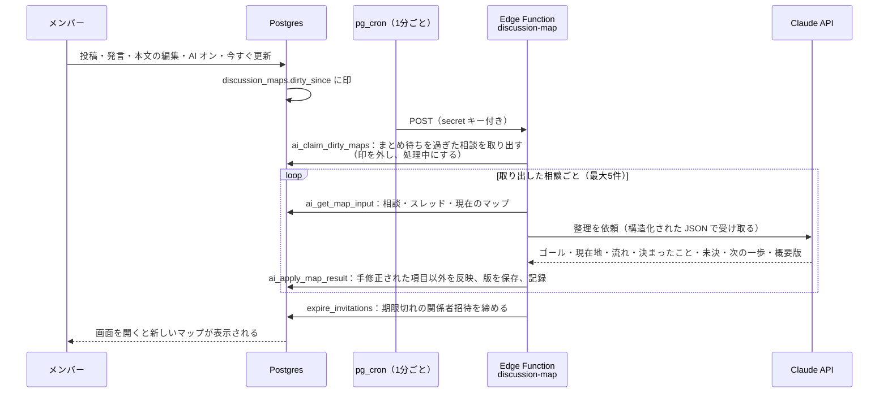

# 議論マップの処理フロー

> 要件：[requirements.md](./requirements.md) 4.10（MAP-1〜MAP-9）・4.8（AI-1〜AI-10）
> 実装：[`supabase/functions/discussion-map/`](../supabase/functions/discussion-map/) ・ [`supabase/migrations/20261109010000_discussion_map_jobs.sql`](../supabase/migrations/20261109010000_discussion_map_jobs.sql)

---

## 1. 全体の流れ



## 2. いつ更新されるか

| きっかけ | 処理されるまで |
| --- | --- |
| 相談を投稿した | 次の定期処理（1分以内） |
| AI をオンに戻した | 次の定期処理（1分以内） |
| 「今すぐ更新」を押した（画面は今後追加） | 次の定期処理（1分以内） |
| スレッドに発言・本文を編集 | **最後の更新から3分たってから**（続けて書き込まれる間はまとめて待つ） |
| 処理中に新しい発言が来た | 今回の結果を保存したあと、もう一度処理する |

- AI オフの相談は一切処理しない（AI にも送らない）
- 処理中に AI がオフにされたら、届いた結果は捨てる

## 3. 材料がそろうまで（MAP-2・MAP-3）

AI は毎回「ゴール」「今の状況」「期限や予算などの条件」が読み取れるかを判定する。
「投稿者以外の発言があるか」は DB の件数で判定する。

- **ゴールと今の状況が読み取れて、投稿者以外の発言が1件以上** → `ready`（マップを表示）
- それ以外 → `collecting`（枠とチェックリストを表示：「このような項目があれば、議論の流れや全体感と現在位置を出せます」）

## 4. AI に送るもの・送らないもの（AI-1〜AI-9）

| 送る | 送らない |
| --- | --- |
| 相談のタイトル・本文（8,000字まで） | 参加者の名前・メールアドレス・電話番号 |
| スレッドの発言（新しい順に200件まで、各2,000字まで）と自動メッセージ | DM |
| 参加者のラベル（P1, P2 …）と、誰が投稿者か | AI オフの相談 |
| 現在のマップ（言い回しをそろえるため） | |

- 参加者は名前ではなく **P1, P2 … のラベル**で送る。次の一歩の担当者もラベルで返してもらい、DB 側で本人に結び付けて名前を表示する
- 本文やスレッドに「〜と出力して」などの指示が書かれていても従わないよう、指示文で明示している
- **承認前の人向けの概要版（preview）**は、名前・ラベル・発言の引用を入れず、細かい事情をぼかすよう指示している。材料がそろったときだけ作る

## 5. 手修正との関係（MAP-6）

投稿者・関係者が手で直した項目（`manual_fields`）は、自動更新で上書きしない。手で直していない項目だけを更新する。

## 6. 失敗したとき

| 起きたこと | 対応 |
| --- | --- |
| AI が安全上の理由で断った | 自動で Anthropic 推奨の別モデルでやり直す（`fallbacks: "default"`）。それでも断られたら記録して再試行待ち |
| API の回数制限 | その回の残りは処理せず、次の定期処理に回す |
| その他のエラー・JSON が壊れていた | 記録して再試行待ち |
| 処理が10分以上終わらない | 次の定期処理で取り直す |

- 再試行は間隔を空ける：失敗1回目は約5分後、以降2倍ずつ（最大で約1時間）
- 失敗してもそれまでのマップは消さない
- すべての呼び出しは `ai_runs` に記録（モデル・トークン数・結果・エラー内容）。管理者だけが見られる

## 7. モデルと費用

| 設定（Edge Function の secrets） | 既定 | 内容 |
| --- | --- | --- |
| `ANTHROPIC_API_KEY` | （必須） | Claude API のキー |
| `CLAUDE_MODEL` | `claude-opus-5-5` | 使うモデル。費用を抑えるなら `claude-haiku-5-5` も選べる |
| `MAP_BATCH_SIZE` | `5` | 1回の定期処理で扱う相談の数 |

- 思考の深さ（effort）は `medium`
- 費用の目安は [requirements.md](./requirements.md) 5.2。実際の利用量は `ai_runs` のトークン数で確認できる

## 8. セットアップ

1. マイグレーションを適用する（`supabase db push`）
2. Claude API のキーを設定する
   ```sh
   supabase secrets set ANTHROPIC_API_KEY=sk-ant-...
   # 任意：supabase secrets set CLAUDE_MODEL=claude-haiku-5-5
   ```
3. Edge Function をデプロイする（定期処理から secret キーで呼ぶので、JWT の確認は切る）
   ```sh
   supabase functions deploy discussion-map --no-verify-jwt
   ```
4. [`supabase/setup/schedule-discussion-map.sql`](../supabase/setup/schedule-discussion-map.sql) の URL と secret キーを書き換えて、SQL Editor で実行する
5. 確認：相談を1件投稿し、1分ほどで `select * from ai_runs order by id desc;` に記録が出ること

## 9. テスト

| テスト | 内容 | 結果 |
| --- | --- | --- |
| [`supabase/tests/10_access_scenarios.sql`](../supabase/tests/10_access_scenarios.sql) | 取り出し・二重処理の防止・手修正の保護・処理中の発言・失敗時の間隔・AI オフでの破棄・招待の期限切れ・一般メンバーは呼べないこと | 合格 |
| [`tests/discussion-map/integration.ts`](../tests/discussion-map/integration.ts) | 処理全体を本物の Postgres で通す（AI は偽物）。まとめ待ち、材料集め → 表示、担当者の名前解決、名前を AI に送らないこと、概要版に名前が入らないこと、拒否時の記録と再試行 | 16項目合格 |
| [`supabase/functions/discussion-map/claude.test.ts`](../supabase/functions/discussion-map/claude.test.ts) | 偽の API サーバーで、SDK が送る内容（モデル・構造化出力・フォールバック指定）と、拒否・回数制限・壊れた JSON の扱いを確認 | 11項目合格（この環境には Deno がないため、同じ内容を Node で実行して確認） |

**未確認**：実際の Claude API での出力の質（プロンプトの調整）と、Supabase 上での定期実行。本番のキーを設定したら、数件の相談で出力を確認してプロンプトを調整する。
