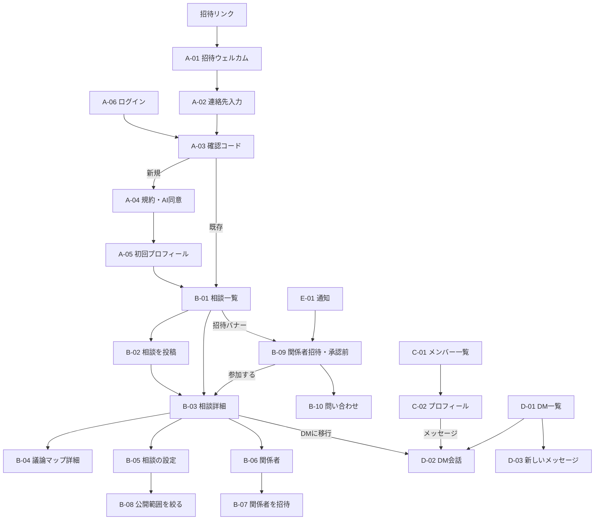

# 画面一覧・ワイヤーフレーム（v0.1）

> 要件：[requirements.md](./requirements.md) ／ 決定記録：[decisions.md](./decisions.md)
>
> ワイヤーフレームはスマホ表示を基本に描いている（レスポンシブ。PC 版のレイアウトは「0. 共通レイアウト」参照）。
> 図の右端の枠線は、全角文字でずれないよう省略している。

---

## 0. 共通レイアウト

### スマホ（〜767px）：下部タブ

```
┌─────────────────────────────
│ 画面タイトル            🔔
├─────────────────────────────
│
│   （メインコンテンツ）
│
├─────────────────────────────
│ 🏠相談  👥メンバー  ✉DM  👤マイ
└─────────────────────────────
```

### PC・タブレット（768px〜）：左サイドバー＋メイン（＋右パネル）

```
┌──────────────┬──────────────────────────────┬────────────────
│ inner-chat   │ 画面タイトル                  │ 補助パネル
│              │                              │ （相談詳細では
│ 🏠 相談       │                              │   議論マップ、
│ 👥 メンバー   │   （メインコンテンツ）          │   DMでは相手の
│ ✉ DM     3  │                              │   プロフィール）
│ 🔔 通知   5  │                              │
│ 👤 マイページ │                              │
│ ⚙ 管理       │ ← 管理者のみ表示              │
└──────────────┴──────────────────────────────┴────────────────
```

- 通知はスマホでは右上の 🔔、PC ではサイドバーに表示
- 「管理」は管理者にだけ表示
- 文字サイズは「標準／大」をマイページで切り替え可能（使いやすさ要件）

---

## 1. 画面一覧

### A. 登録・ログイン

| ID | 画面名 | 主な内容 | 関連要件 |
| --- | --- | --- | --- |
| A-01 | 招待ウェルカム | 招待リンクから開く。招待した管理者名、サービス説明、「はじめる」 | A-3, A-4 |
| A-02 | 連絡先入力 | メールアドレス入力（標準）／「電話番号で登録する」リンク | A-1, A-2 |
| A-03 | 確認コード入力 | 6桁コード入力、再送、試行回数制限の表示 | A-1, A-2 |
| A-04 | 規約・AI 利用の同意 | 利用規約、AI 利用の説明、同意チェック | A-10, AI-1, AI-4 |
| A-05 | 初回プロフィール設定 | 表示名・アイコン・ひとこと → できることタグ（スキップ可） | P-1〜P-3 |
| A-06 | ログイン | メール／電話番号を入力 → A-03 へ | A-1, A-2 |
| A-07 | 招待リンク無効 | 期限切れ・使用済みの案内、管理者への連絡方法 | A-4 |

### B. 相談

| ID | 画面名 | 主な内容 | 関連要件 |
| --- | --- | --- | --- |
| B-01 | 相談一覧（ホーム） | 閲覧できる相談の一覧、絞り込み（すべて／自分の／関係者になっている／ステータス）、新規投稿ボタン、届いている関係者招待のバナー | C-2, C-8 |
| B-02 | 相談を投稿 | タイトル、本文、公開範囲、関係者選択、管理者閲覧の許可、AI 利用、タグ（任意） | C-1, V-1, V-2, V-9, V-10, AI-2, AI-6 |
| B-03 | 相談詳細 | 相談ヘッダー（公開範囲・管理者閲覧・AI の状態）、議論マップ（折りたたみ可）、本文、反応、スレッド、入力欄 | C-3, C-4, MAP-*, V-13, AI-10 |
| B-04 | 議論マップ詳細 | 全項目表示、手修正、今すぐ更新、過去の版 | MAP-4〜MAP-8, AI-8 |
| B-05 | 相談の設定 | 公開範囲の変更、管理者閲覧のオン／オフ、AI 利用のオン／オフ、ステータス変更（投稿者のみ） | V-3, V-6, V-11, AI-6, AI-9, C-8 |
| B-06 | 関係者 | 関係者一覧、承認待ち招待、招待する、外す（投稿者のみ）、自分が抜ける | V-5, I-1, I-6, I-8 |
| B-07 | 関係者を招待 | メンバー選択（タグ検索可）、ひとことメッセージ | I-1, I-2 |
| B-08 | 公開範囲を絞る | 全体→関係者のみ 時の、これまでの参加者から関係者を選ぶ画面 | V-4 |
| B-09 | 関係者招待（承認前） | タイトル、投稿者、招待者、メッセージ、関係者一覧、議論マップ概要版、「参加する／辞退する／質問する」 | I-3〜I-5, I-7, MAP-7 |
| B-10 | 招待についての問い合わせ | 招待に紐づく会話（招待された人 ⇔ 招待者・投稿者） | I-5 |

### C. メンバー

| ID | 画面名 | 主な内容 | 関連要件 |
| --- | --- | --- | --- |
| C-01 | メンバー一覧・検索 | キーワード／タグで検索、相談受付ステータスで絞り込み、カード表示 | P-6 |
| C-02 | メンバープロフィール | 自己紹介、できること（経験・実績）、勉強中、ステータス、「メッセージを送る」、ブロック・通報 | P-1〜P-7, D-5 |

### D. DM

| ID | 画面名 | 主な内容 | 関連要件 |
| --- | --- | --- | --- |
| D-01 | DM 一覧 | 会話一覧（未読数・最終メッセージ）、新規作成 | D-1, D-2 |
| D-02 | DM 会話 | メッセージ、既読、画像・ファイル添付、元の相談へのリンク（相談から移行した場合） | D-1, D-3, D-4, C-5 |
| D-03 | 新しいメッセージ | 宛先選択（1人＝1対1、複数＝グループ）、グループ名 | D-1, D-2 |

### E. 通知

| ID | 画面名 | 主な内容 | 関連要件 |
| --- | --- | --- | --- |
| E-01 | 通知一覧 | 反応・メンション・DM・関係者招待（受信／承認／辞退／問い合わせ）・おすすめ相談 | N-1 |

### F. マイページ

| ID | 画面名 | 主な内容 | 関連要件 |
| --- | --- | --- | --- |
| F-01 | マイページ | 自分のプロフィール表示、各設定への入口 | — |
| F-02 | プロフィール編集 | 表示名、アイコン、自己紹介、相談受付ステータス | P-1, P-5 |
| F-03 | できること編集 | タグ追加（候補から選択／新規）、経験レベル、実績例、勉強中 | P-2〜P-4, P-7 |
| F-04 | アカウント | メール／電話番号の追加・変更、ログアウト、退会 | A-6, A-9 |
| F-05 | 通知設定 | 通知の種類ごとのオン／オフ、メール頻度、Web プッシュ許可 | N-2, N-3 |
| F-06 | ブロック・ミュート | ブロック中・ミュート中の一覧と解除 | D-5 |
| F-07 | 表示設定 | 文字サイズ、ホーム画面に追加（PWA）の案内 | 非機能 |

### G. 管理（管理者のみ）

| ID | 画面名 | 主な内容 | 関連要件 |
| --- | --- | --- | --- |
| G-01 | 管理ホーム | 未対応の通報数、メンバー数、有効な招待リンク数 | — |
| G-02 | メンバー管理 | 一覧、管理者に格上げ／一般に戻す、停止・退会処理、招待者の表示 | A-7, A-8, M-1, M-2 |
| G-03 | 招待リンク | 発行（有効期限・使用回数・メモ）、コピー／共有、履歴と使用状況、無効化 | A-3〜A-5 |
| G-04 | 通報 | 通報一覧、対象の閲覧（関係者のみでも可）、対応記録 | M-3, V-12 |
| G-05 | タグ整理 | タグ一覧、使用数、統合・名前変更 | M-4 |

### 共通ダイアログ

| ID | 名前 | 使う場面 |
| --- | --- | --- |
| X-01 | 通報 | 相談・発言・DM・プロフィールから |
| X-02 | 公開範囲を広げる確認 | 関係者のみ → 全体（V-6） |
| X-03 | 関係者を外す確認 | B-06 から |
| X-04 | AI 利用をオフにする確認 | B-02 / B-05 から（生成済みマップの扱いを説明） |

---

## 2. 画面遷移



---

## 3. ワイヤーフレーム

### A-01 招待ウェルカム

```
┌─────────────────────────────
│
│        inner-chat
│
│   山田さんから招待が届いています
│
│   知り合い同士で「できること」を
│   持ち寄って、ちょっとした相談を
│   気軽にできる場所です。
│
│   ・パスワードは不要です
│   ・アプリのインストールも不要です
│
│  ┌───────────────────────
│  │        はじめる
│  └───────────────────────
│
│   すでに登録済みの方は ログイン
└─────────────────────────────
```

### A-02 連絡先入力 / A-03 確認コード入力

```
┌─────────────────────────────        ┌─────────────────────────────
│ ←  登録                              │ ←  確認コード
├─────────────────────────────        ├─────────────────────────────
│                                     │
│ メールアドレス                        │ taro@example.com に
│ ┌──────────────────────              │ 6桁のコードを送りました
│ │ taro@example.com                   │
│ └──────────────────────              │  ┌──┐┌──┐┌──┐┌──┐┌──┐┌──┐
│                                     │  │ 4││ 8││ 1││  ││  ││  │
│ ┌──────────────────────              │  └──┘└──┘└──┘└──┘└──┘└──┘
│ │  確認コードを送る                   │
│ └──────────────────────              │ 届かない場合
│                                     │  ・迷惑メールフォルダを確認
│ メールを使いたくない方は               │  ・コードを再送する（60秒後）
│ → 電話番号（SMS）で登録する           │
└─────────────────────────────        └─────────────────────────────
```

### A-04 規約・AI 利用の同意

```
┌─────────────────────────────
│ ←  ご利用にあたって
├─────────────────────────────
│ ■ 利用規約（全文を見る）
│
│ ■ AI の利用について
│  相談の本文とスレッドは、要約・タグ付け・
│  議論の流れの整理のため、AI（Anthropic
│  の Claude）に送られます。
│  ・「関係者のみ」の相談も対象です
│  ・DM は送られません
│  ・相談ごとに AI を使わない設定にできます
│  ・送った内容が AI の学習に使われることは
│    ありません
│
│ ☐ 利用規約と AI の利用に同意します
│
│ ┌──────────────────────
│ │  同意して次へ
│ └──────────────────────
└─────────────────────────────
```

### A-05 初回プロフィール設定

```
┌─────────────────────────────
│    プロフィール（2 / 2）
├─────────────────────────────
│ あなたの「できること」を教えてください
│ あとからいつでも追加・変更できます
│
│ ┌──────────────────────
│ │ 🔍 タグを検索・追加
│ └──────────────────────
│ よく使われているタグ
│ [Web制作] [デザイン] [税務] [子育て]
│ [写真] [英語] [IT相談] [料理] …
│
│ 選択中：[Web制作 ×] [写真 ×]
│
│ ひとこと（任意）
│ ┌──────────────────────
│ │ 平日夜なら相談乗れます
│ └──────────────────────
│
│ [ あとで ]        [ はじめる ]
└─────────────────────────────
```

### B-01 相談一覧（ホーム）

```
┌─────────────────────────────
│ 相談                      🔔3
├─────────────────────────────
│ ┌──────────────────────────
│ │ ✉ 関係者招待が1件届いています  →
│ └──────────────────────────
│ [すべて][自分の][関係者][募集中▾]
│
│ ┌──────────────────────────
│ │ 店のWebサイトをなんとかしたい
│ │ 🌐全体  募集中   佐藤 ・ 2時間前
│ │ 「何から手をつければいいか…」
│ │ #Web制作 #マーケ
│ │ 💬 5   🙋 話聞けます 2
│ │ 📍 現在地：② 情報・選択肢集め
│ └──────────────────────────
│ ┌──────────────────────────
│ │ 実家の相続手続きについて
│ │ 🔒関係者のみ(4) 進行中 鈴木 ・昨日
│ │ 💬 12
│ │ 📍 現在地：③ 検討・比較
│ └──────────────────────────
│ ┌──────────────────────────
│ │ 子どもの習い事、何がいい？
│ │ 🌐全体  募集中  🤖AIオフ 田中・3日前
│ │ 💬 1
│ └──────────────────────────
│                         ┌────
│                         │ ＋ 相談する
│                         └────
├─────────────────────────────
│ 🏠相談  👥メンバー  ✉DM  👤マイ
└─────────────────────────────
```

### B-02 相談を投稿

```
┌─────────────────────────────
│ ✕  相談する               投稿
├─────────────────────────────
│ タイトル
│ ┌──────────────────────
│ │ 店のWebサイトをなんとかしたい
│ └──────────────────────
│ 内容（ふわっとで大丈夫です）
│ ┌──────────────────────
│ │ 小さな飲食店をやっています。
│ │ 今のサイトが古くて…
│ │
│ └──────────────────────
│ 💡 こんなことが書いてあると、話が進みやすく
│    なります：やりたいこと／今の状況／
│    期限や予算
│
│ ── 公開範囲 ──────────────
│ (●) 🌐 全体に公開
│ ( ) 🔒 関係者のみ
│
│   ┌ 関係者のみ を選んだときだけ表示 ─────
│   │ 関係者  [＋ 選ぶ]  佐藤 × 高橋 ×
│   │  ※選んだ人には招待が届き、承認すると参加
│   │ ☑ 管理者の閲覧を許可する
│   │   調整や仲裁が必要になった場合に備えて、
│   │   管理者が内容を確認できるようにします
│   └──────────────────────
│
│ ── AI ──────────────────
│ ☑ AI を使う
│   内容を AI が要約し、議論の流れを整理します。
│   合いそうな人へのおすすめにも使います
│   （全体公開のみ）
│
│ タグ（任意・AI が提案します）
│ [＋ タグを追加]
└─────────────────────────────
```

### B-03 相談詳細（スマホ）

```
┌─────────────────────────────
│ ←  相談                ⚙  ⋯
├─────────────────────────────
│ 店のWebサイトをなんとかしたい
│ 佐藤 ・ 2時間前   募集中
│ 🌐全体公開  🤖AIオン
│   （関係者のみの場合：🔒関係者のみ 4人 ›
│     👁 管理者閲覧：許可）
│
│ ┌ 📍 議論マップ ─────────── ▾
│ │ ゴール：お店のサイトを作り直して
│ │         予約を増やしたい
│ │
│ │ ①課題整理 ─ ❷情報集め ─ ③検討 ─ ④決定 ─ ⑤実行
│ │              ▲いまここ
│ │
│ │ これまでの流れ
│ │  1. 今のサイトの問題点を共有
│ │  2. 予約システムの有無が論点に
│ │
│ │ 未決：予算／自分で更新したいか
│ │ 次の一歩：参考サイトを3つ挙げる（佐藤）
│ │ 10分前に更新          詳しく見る ›
│ └──────────────────────────
│
│ 小さな飲食店をやっています。
│ 今のサイトが古くて…（本文）
│ #Web制作 #マーケ
│
│ [🙋 話聞けます 2] [💡 詳しい人知ってます 1]
│
│ ── スレッド ───────────────
│ 高橋  1時間前
│  予約システムって今使ってますか？
│ 佐藤  50分前
│  電話だけです
│ ⚙ 高橋さんが「話聞けます」と反応しました
│ 伊藤  30分前
│  @中村 さんが飲食店のサイト作ってました
│          [ DMで話す ] [ 返信 ]
├─────────────────────────────
│ ＋  メッセージを入力…          ➤
└─────────────────────────────
```

### B-03 相談詳細（PC）

```
┌────────────┬─────────────────────────────────┬──────────────────────────
│ inner-chat │ ← 店のWebサイトをなんとかしたい   ⚙ │ 📍 議論マップ    ↻ 更新
│            │ 佐藤・2時間前 募集中 🌐全体 🤖AIオン │
│ 🏠 相談     │                                 │ ゴール
│ 👥 メンバー │ 小さな飲食店をやっています。…       │  サイトを作り直して
│ ✉ DM    3 │ #Web制作 #マーケ                  │  予約を増やしたい
│ 🔔 通知  5 │ [🙋 話聞けます 2] [💡 1]           │
│ 👤 マイ     │ ─── スレッド ───────────           │ 現在地
│            │ 高橋：予約システムって…              │  ① ─ ❷ ─ ③ ─ ④ ─ ⑤
│            │ 佐藤：電話だけです                  │
│            │ 伊藤：@中村 さんが…                 │ これまでの流れ
│            │                                 │  1. 問題点を共有
│            │                                 │  2. 予約システムが論点
│            │                                 │ 決まったこと：—
│            │                                 │ 未決：予算／更新方法
│            │ ┌───────────────────────────    │ 次の一歩：参考サイト3つ
│            │ │ メッセージを入力…         ➤     │ 10分前 ・ 過去の版 ›
└────────────┴─────────────────────────────────┴──────────────────────────
```

### B-03 議論マップ：材料が足りないとき／AI オフのとき

```
┌ 📍 議論マップ ───────────────          ┌ 📍 議論マップ ───────────────
│ このような項目があれば、議論の           │ この相談は AI を使わない設定です
│ 流れや全体感と現在位置を出せます         │
│                                       │ ゴール     [ 入力する ]
│  ☑ 何をしたいか（ゴール）               │ 現在地     ① ② ③ ④ ⑤ から選ぶ
│  ☐ 今の状況                            │ 決まったこと [ 入力する ]
│  ☐ 期限や予算などの条件                 │ 未決の論点  [ 入力する ]
│  ☐ 投稿者以外の発言（1件以上）          │ 次の一歩   [ 入力する ]
│                                       │
│ ①課題整理 ─ ②情報集め ─ ③検討          │ 投稿者・関係者が編集できます
│   ─ ④決定 ─ ⑤実行   （未判定）          │
└───────────────────────────────        └───────────────────────────────
```

### B-04 議論マップ詳細

```
┌─────────────────────────────
│ ←  議論マップ          ↻ 今すぐ更新
├─────────────────────────────
│ 10分前に AI が更新 ・ 版 4  過去の版 ›
│
│ ゴール                     ✎
│  お店のサイトを作り直して予約を増やしたい
│
│ 現在地                     ✎
│  ①課題整理 ─ ❷情報集め ─ ③ ─ ④ ─ ⑤
│
│ これまでの流れ               ✎
│  1. 今のサイトの問題点を共有
│  2. 予約システムの有無が論点に
│  3. 中村さんが紹介された
│
│ 決まったこと                 ✎
│  ・スマホで見やすくする
│
│ 未決の論点                   ✎
│  ・予算  ・自分で更新したいか
│
│ 次の一歩                     ✎
│  ・参考サイトを3つ挙げる（佐藤）
│
│ ✋ 手で直した項目には「手修正」と表示され、
│    自動更新では上書きされません
└─────────────────────────────
```

### B-05 相談の設定（投稿者のみ）

```
┌─────────────────────────────
│ ←  相談の設定
├─────────────────────────────
│ ステータス
│  (●)募集中 ( )進行中 ( )解決 ( )クローズ
│
│ 公開範囲
│  ( ) 🌐 全体に公開
│  (●) 🔒 関係者のみ（4人）    関係者 ›
│
│ ☑ 管理者の閲覧を許可する
│   調整や仲裁が必要になった場合に備えて、
│   管理者が内容を確認できるようにします
│
│ ☑ AI を使う
│   オフにすると、以降は AI に送られません。
│   作成済みの議論マップは残ります。
│
│ 変更はスレッドに記録されます
└─────────────────────────────
```

### B-06 関係者 / B-07 関係者を招待

```
┌─────────────────────────────        ┌─────────────────────────────
│ ←  関係者（4人）                      │ ←  関係者を招待             送る
├─────────────────────────────        ├─────────────────────────────
│ ┌──────────────────────              │ 🔍 名前・タグで検索
│ │ ＋ 関係者を招待する                  │ ┌──────────────────────
│ └──────────────────────              │ │ デザイン
│                                     │ └──────────────────────
│ 参加中                               │ ☑ 中村  #デザイン #Web制作
│  佐藤（投稿者）                        │ ☐ 小林  #デザイン #写真
│  高橋                     外す         │
│  伊藤                     外す         │ ひとことメッセージ
│  自分             この相談から抜ける      │ ┌──────────────────────
│                                     │ │ デザイン面で意見をもらえると
│ 承認待ち                              │ │ 助かります
│  中村  招待：伊藤 ・ 残り13日            │ └──────────────────────
│                    取り消す（投稿者）    │
│ 辞退・期限切れ                         │ ※相手が承認すると参加します
│  小林  辞退                           │ ※投稿者にも通知されます
└─────────────────────────────        └─────────────────────────────
```

### B-09 関係者招待（承認前）

```
┌─────────────────────────────
│ ←  関係者への招待
├─────────────────────────────
│ 伊藤さんから招待が届いています
│ ┌──────────────────────
│ │ デザイン面で意見をもらえると
│ │ 助かります
│ └──────────────────────
│
│ 相談：店のWebサイトをなんとかしたい
│ 投稿者：佐藤
│ 関係者：佐藤・高橋・伊藤（3人）
│ 🔒関係者のみ ・ 👁管理者閲覧：許可
│
│ ┌ 📍 議論マップ（概要） ────────
│ │ ゴール：お店のサイトを作り直して
│ │         予約を増やしたい
│ │ ①課題整理 ─ ❷情報集め ─ ③ ─ ④ ─ ⑤
│ │ 流れ：問題点の共有 → 予約の仕組みが論点に
│ │ 未決：予算／更新方法
│ └──────────────────────
│ ※本文とスレッドは参加後に見られます
│
│ 期限：あと13日
│
│ ┌──────────────────────
│ │       参加する
│ └──────────────────────
│ [ 💬 質問する ]       [ 辞退する ]
└─────────────────────────────
```

### B-10 招待についての問い合わせ

```
┌─────────────────────────────
│ ←  招待についての質問
│     店のWebサイト… ／ 伊藤・佐藤
├─────────────────────────────
│ 中村
│  どのくらいの時間がかかりそうですか？
│                       伊藤
│        最初は30分くらい話を聞いてほしい
│        です                         
│
├─────────────────────────────
│ メッセージを入力…               ➤
│ [ 参加する ]           [ 辞退する ]
└─────────────────────────────
```

### C-01 メンバー一覧・検索 / C-02 プロフィール

```
┌─────────────────────────────        ┌─────────────────────────────
│ メンバー（42人）                      │ ←  中村
├─────────────────────────────        ├─────────────────────────────
│ 🔍 名前・できることで検索               │  (◯)  中村 健
│ [すべて][相談受付中] [タグ▾]           │       🟢 相談受付中
│                                     │  飲食店のサイトを中心に作ってます
│ ┌──────────────────────              │
│ │ (◯) 中村  🟢受付中                  │ ── できること ──
│ │ #Web制作 #デザイン                  │ Web制作  ★★★ 経験10年
│ │ 飲食店のサイトを中心に…              │  実績：カフェ、居酒屋のサイト
│ └──────────────────────              │ デザイン ★★
│ ┌──────────────────────              │
│ │ (◯) 鈴木  🟡ちょっと忙しい          │ ── 勉強中 ──
│ │ #税務 #相続                        │ 動画編集
│ │ 税理士です                          │
│ └──────────────────────              │ ┌──────────────────────
│ ┌──────────────────────              │ │   ✉ メッセージを送る
│ │ (◯) 田中  ⚪休止中                  │ └──────────────────────
│ │ #子育て #料理                       │            ⋯ ブロック・通報
│ └──────────────────────              │
└─────────────────────────────        └─────────────────────────────
```

### D-01 DM 一覧 / D-02 DM 会話

```
┌─────────────────────────────        ┌─────────────────────────────
│ メッセージ                  ✎         │ ←  中村                    ⋯
├─────────────────────────────        ├─────────────────────────────
│ 🔍 検索                              │ 📎 相談「店のWebサイト…」から
│                                     │
│ (◯) 中村                   10:24 ●  │ 佐藤
│     来週どこかで話しましょう           │  先ほどはありがとうございます
│ (◯) 高橋                   昨日     │                       中村
│     了解です！                        │       来週どこかで話しましょう
│ (◯◯) 町内会イベント（4）    月曜      │                           既読
│     伊藤：写真まとめました             │
│                                     │
│                                     ├─────────────────────────────
│                                     │ 📷  📎  メッセージを入力…    ➤
└─────────────────────────────        └─────────────────────────────
```

### E-01 通知一覧

```
┌─────────────────────────────
│ 通知                すべて既読
├─────────────────────────────
│ ● ✉ 伊藤さんから関係者招待が届きました
│     「店のWebサイト…」      5分前
│ ● 🙋 高橋さんが「話聞けます」と反応
│     「店のWebサイト…」      1時間前
│ ● ✨ あなたに合いそうな相談があります
│     「チラシのデザインを…」 #デザイン
│   @ 伊藤さんがあなたをメンションしました
│   ✅ 中村さんが招待を承認しました
└─────────────────────────────
```

### F-01 マイページ / F-03 できること編集

```
┌─────────────────────────────        ┌─────────────────────────────
│ マイページ                            │ ←  できること             保存
├─────────────────────────────        ├─────────────────────────────
│  (◯) 佐藤 太郎      編集 ›            │ 🔍 タグを検索・追加
│      🟢 相談受付中 ▾                  │
│  #Web制作 #写真                       │ ┌ Web制作 ─────────── 🗑
│                                     │ │ 経験  ( )少し (●)そこそこ ( )本職
│ できること                    ›       │ │ 実績・ひとこと
│ アカウント（メール・電話）       ›       │ │ ┌──────────────────
│ 通知設定                      ›       │ │ │ 知人の店のサイトを2件
│ ブロック・ミュート              ›       │ │ └──────────────────
│ 表示設定（文字サイズ）          ›       │ └──────────────────────
│ ホーム画面に追加                ›       │ ┌ 写真 ────────────── 🗑
│                                     │ │ …
│ ログアウト                            │ └──────────────────────
│                                     │ ── 勉強中・興味あり ──
│                                     │ [動画編集 ×] [＋ 追加]
└─────────────────────────────        └─────────────────────────────
```

### G-02 メンバー管理 / G-03 招待リンク

```
┌─────────────────────────────        ┌─────────────────────────────
│ ←  メンバー管理（42人）               │ ←  招待リンク
├─────────────────────────────        ├─────────────────────────────
│ 🔍 検索   [すべて][管理者][停止中]     │ ┌──────────────────────
│                                     │ │ ＋ 招待リンクを発行
│ 山田（自分） 👑管理者                  │ └──────────────────────
│ 佐藤        👑管理者        ⋯         │  有効期限  [ 7日 ▾ ]
│ 中村        招待：山田 11/1  ⋯         │  使用回数  [ 1回 ▾ ]
│ 鈴木        ⛔停止中        ⋯         │  メモ     [ 中村さん用 ]
│                                     │
│  ⋯ メニュー                           │ 有効なリンク
│   ・管理者にする / 一般に戻す          │  中村さん用  残り5日  未使用
│   ・停止する / 停止を解除             │      [コピー] [共有] [無効化]
│   ・退会させる                        │ 使用済み・無効
│  ※最後の管理者は一般に戻せません       │  高橋さん用  11/2 使用（高橋）
└─────────────────────────────        └─────────────────────────────
```

### G-04 通報

```
┌─────────────────────────────
│ ←  通報（未対応 1）
├─────────────────────────────
│ ● 未対応
│   対象：相談「〇〇」の発言（🔒関係者のみ）
│   通報者：高橋 ・ 理由：攻撃的な発言
│   11/7 21:03                  確認する ›
│
│   対応済み
│   対象：DM（伊藤）  11/1  対応：注意済み
│
│ ※通報された内容は、管理者閲覧がオフの
│   相談でも確認できます
└─────────────────────────────
```

---

## 4. 未確定・今後詰める点

- アイコン・配色などのビジュアルデザイン（このワイヤーフレームは構成のみ）
- 文言の最終調整（特に AI 利用の説明、管理者閲覧の説明）
- PC 版で右パネルに出す内容の画面ごとの詳細
